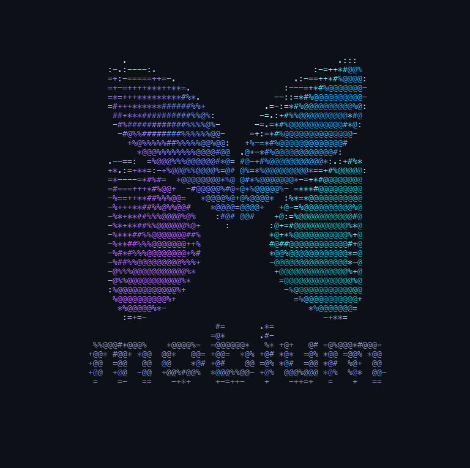

## Hi, I'm Lana Begunova

**SDET · QA and AI test automation — mobile, web, and the tools behind them.**
I build automation tooling, test it on real devices, and measure whether its results can be trusted.
Seattle, WA · [LinkedIn](https://linkedin.com/in/LanaBegunova) · [lanabegunova.com](http://lanabegunova.com) · [Medium](https://medium.com/@begunova) · [YouTube](https://youtube.com/LanaBegunova)

### What I'm building

**[Mobium](https://github.com/mobiumdev/mobium)**: mobile app automation for AI agents and humans. One Go binary drives Android emulators and phones, iOS simulators and iPhones, Fire TV and Apple TV through a CLI, an MCP server, and five language clients.
- Creator and lead maintainer: 167 merged PRs, CI on macOS, Linux and Windows
- Verified on real hardware, not just emulators: most defects I logged showed up only on a real device
- Companion repos: [mobium-app](https://github.com/mobiumdev/mobium-app), a React Native app under test where every screen is a positive control, and the [docs site](https://mobiumdev.github.io)

### Open source testing

**[Vibium](https://github.com/VibiumDev/vibium)** (browser automation for AI agents): 51 issues filed upstream, each with a measured root cause, plus independent regression suites in
[Python](https://github.com/lana-20/vibium-python-test), [Java](https://github.com/lana-20/vibium-java-test) and [TypeScript](https://github.com/lana-20/vibium-js-test), and for the [CLI](https://github.com/lana-20/vibium-cli-test) and [MCP server](https://github.com/lana-20/vibium-mcp-test).

**AI agents for testing:** Claude Code skills for [exploratory testing](https://github.com/lana-20/practice-testing) and for [hunting hydration races](https://github.com/lana-20/candy-mapping) in web UIs, and a [course](https://github.com/lana-20/agent-test-automation) on single- and multi-agent test automation with Playwright, Vibium and Selenium WebDriver BiDi.

### Speaking

- **PNSQC 2026**: poster paper, [*Skip the Wrapper: Making a Browser-Automation CLI Faster*](https://lana-20.github.io/pnsqc-2026-poster). I measured five CLI optimizations under fixed semantics; the one that shipped was a packaging change.
- **Microsoft Reactor** (InnovateQA): [*Configuring and Launching Appium Mobile Sessions in 30 Minutes*](https://youtu.be/41nBwNj1Qaw)
- **Microsoft Reactor** (InnovateQA): [*Valet All-Day: Next-Gen AI-Native Mobile Stack*](https://youtu.be/_F9vYEBWP_4)
- **AB Testing podcast**: [Episode 238, Part 1](https://creators.spotify.com/pod/profile/abtesting/episodes/Episode-238-Lana-Begunova---Part-1-e3p2slv) (Part 2 coming soon)

### Writing

- **[Simply Automation](https://github.com/lana-20/simply-automation)**: a free, openly licensed book on the history of automation, one tool at a time (written as Serene Dipster)
- Mobile testing reference notes: [adb logcat](https://github.com/lana-20/adb-logcat-options-filters), [Android Debug Bridge](https://github.com/lana-20/android-debug-bridge), [Charles Proxy setup](https://github.com/lana-20/charles-setup), [Selenium WebDriver BiDi in Java](https://github.com/lana-20/selenium-webdriver-bidi)

### Stack

**Languages:** Go · Python · Java · TypeScript · JavaScript
**Automation:** Appium · Selenium / WebDriver BiDi · Playwright · Vibium · pytest · JUnit
**Mobile:** Android (adb, UiAutomator2, emulators) · iOS (Xcode, XCTest, WebDriverAgent, simulators) · real devices · Charles Proxy
**AI and CI:** MCP servers · Claude Code agents and skills · GitHub Actions
